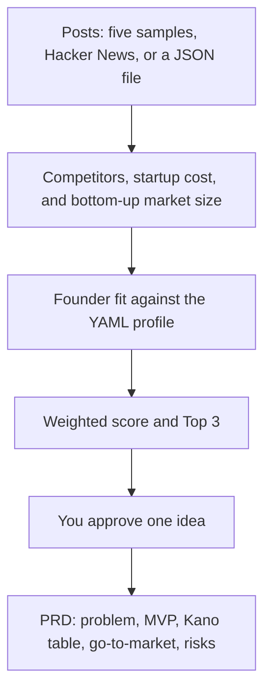

# Lifestyle Startup Discovery

A two-stage agent pipeline that turns pain-point posts into ranked lifestyle-business ideas, then writes a product requirements document for the idea you approve.

A lifestyle business here is a small software product: under the budget in [`config/founder_profile.yaml`](config/founder_profile.yaml) (default $2,500), shippable as a short MVP, and runnable by a small team. The sample set includes an "start an airline" post so you can see an idea rejected for cost and scope.

Live posts come from the [Hacker News Algolia API](https://hn.algolia.com/api). No Reddit API key is required.

## Stack

| Layer | Choice |
| :--- | :--- |
| API | Python, FastAPI, Uvicorn |
| Agents | LangGraph, one node per specialist |
| Model | Gemini (`gemini-2.5-flash` by default) via LangChain |
| Contracts | Pydantic v2 |
| Agent instructions | [Agent Skills](https://agentskills.io/home) files in `.agents/skills/` |
| Founder constraints | `config/founder_profile.yaml` |
| Pain points | Curated fixtures, Hacker News, optional Reddit RSS |
| Competitor lookup | DuckDuckGo search |
| Approval path | n8n, Google Sheets, and Google Docs |
| Tests | pytest, offline by default |

The weighted score is recomputed in code from five subscores. The model can suggest the parts. It cannot invent the total.

## Run the pipeline

From the repository root in PowerShell:

```powershell
python -m venv .venv
.\.venv\Scripts\Activate.ps1
pip install -r requirements.txt
Copy-Item .env.example .env
```

Set `GEMINI_API_KEY` in `.env` from [Google AI Studio](https://aistudio.google.com/apikey). Leave `API_AUTH_KEY` empty on your machine. Do not commit `.env`.

Edit [`config/founder_profile.yaml`](config/founder_profile.yaml) if the scores should reflect a different budget, skill set, or weekly hour cap.

Then run both stages on the five sample posts:

```powershell
python cli.py --source curated
```

The terminal stays quiet while Gemini works. When it finishes, look for `agent_mode=gemini`. Open the PRD:

```powershell
Get-Content outputs\google_doc_prd_top1.md -TotalCount 40
```

| File | Contents |
| :--- | :--- |
| `outputs/google_doc_prd_top1.md` | PRD for the top idea |
| `outputs/stage1_evaluated_ideas.json` | Every idea, score, market size, cost, and `agent_mode` |
| `outputs/google_sheets_evaluated_ideas.csv` | The same rows, ready to paste into a sheet |

`agent_mode=fallback` means at least one step failed and the built-in writeup was used. The warning above that line names the failure.

The free tier for `gemini-2.5-flash` is small (on the order of 20 requests per day). One curated run uses about 19 calls: one extraction, three calls per idea, then three calls for the PRD. Run it once. Check usage at [ai.dev/rate-limit](https://ai.dev/rate-limit). A `429 RESOURCE_EXHAUSTED` response will not succeed until the daily window resets. Stop that process with Ctrl+C. The last successful files in `outputs/` are still the result.

### A shorter live run

`python cli.py --source hn` fetches at most 3 Hacker News posts so one free-tier day can score them. To score five live stories instead, save a short list and pass it in:

```powershell
@'
import json
from dotenv import load_dotenv
load_dotenv()
from src.tools.search import fetch_hacker_news_pain_points
posts = fetch_hacker_news_pain_points(queries=["Ask HN tool you wish existed"], limit_per_query=5, max_posts=5)[:5]
with open("posts.json", "w", encoding="utf-8") as f:
    json.dump([p.model_dump() for p in posts], f, indent=2)
print("Wrote", len(posts), "posts")
'@ | Set-Content -Encoding utf8 fetch_top5.py

python fetch_top5.py
python cli.py --posts-file posts.json
```

`--posts-file` does not fetch again. The console should say `source=provided`.

`--source reddit_rss` is best-effort. Reddit often blocks anonymous feeds.

## API

Start the server only when you want Swagger or n8n. The CLI does not need it. Use a terminal that is not already running `python -m src.main` — port 8000 can be held by only one process.

```powershell
python -m src.main
```

Open [http://localhost:8000/docs](http://localhost:8000/docs).

The site root, [http://localhost:8000/](http://localhost:8000/), returns 404. That is expected. There is no homepage. A `GET /json/version` 404 is a browser probe, not a failed startup.

| Call | Purpose |
| :--- | :--- |
| `GET /health` | Process is up, skills are loaded |
| `POST /api/v1/stage1/evaluate` | Rank posts. Body for the sample set: `{"posts": [], "source": "curated", "fetch_live": false}` |
| `POST /api/v1/stage2/generate-prd` | Write a PRD. `idea_title` and `core_problem` are required |

Swagger shows the JSON in the browser. It does not write the `outputs/` files. Those files are written only by `cli.py`.

## n8n

n8n is the human-approval path. It calls this API. It does not replace it, and it does not need a Reddit key or an n8n Cloud account. Gemini stays in `.env` on the Python process.

1. Leave `python -m src.main` running.
2. In another terminal, start n8n with `npx n8n`.
3. Import [`n8n/stage1_reddit_to_sheets_evaluator.json`](n8n/stage1_reddit_to_sheets_evaluator.json) and [`n8n/stage2_sheets_human_approval_to_gdoc_prd.json`](n8n/stage2_sheets_human_approval_to_gdoc_prd.json).
4. Connect Google Sheets and Google Docs. The workflows already point at spreadsheet `1GQzKsAm4kjbgDbD3Q13fgmqVZ5iiNnTZ37_LUeVTv0Q` and at `http://localhost:8000`. The tab must be named `Evaluated_Ideas`, with the header row from `outputs/google_sheets_evaluated_ideas.csv`.
5. Run Stage 1. It fetches at most 3 Hacker News posts and waits up to 15 minutes. Rows appear in the sheet. Set one Top 3 row's `Approval_Status` to `Approved`. Stage 2 creates a Google Doc and writes the URL into `Google_Doc_PRD_URL`.

n8n results live in Google Sheets and Google Docs, not in `outputs/`.

If you set `API_AUTH_KEY` on the server, add an `X-API-Key` header on both HTTP nodes. Leave it blank locally.

## How a run moves



Stage 1 extracts one idea per post, estimates competitors and a bottom-up market (reachable buyers times annual price), scores founder fit, and keeps the best three ideas that stay inside the budget.

Stage 2 writes the PRD for the approved idea: problem, value proposition, 30-day MVP, feature priority, go-to-market, risks, and 48-hour tests.

Each step is a LangGraph node. Instructions are loaded from `.agents/skills/` by [`src/skill_loader.py`](src/skill_loader.py).

| Skill | File | Job |
| :--- | :--- | :--- |
| Supervisor | [`.agents/skills/supervisor-orchestrator/SKILL.md`](.agents/skills/supervisor-orchestrator/SKILL.md) | Orders the two stages |
| Market research | [`.agents/skills/competitive-market-researcher/SKILL.md`](.agents/skills/competitive-market-researcher/SKILL.md) | Competitors, market size, startup cost |
| Founder fit | [`.agents/skills/founder-market-fit/SKILL.md`](.agents/skills/founder-market-fit/SKILL.md) | Compares the idea with the YAML profile |
| Evaluator | [`.agents/skills/startup-evaluator/SKILL.md`](.agents/skills/startup-evaluator/SKILL.md) | Scores ideas and picks the Top 3 |
| Product | [`.agents/skills/pm-strategist/SKILL.md`](.agents/skills/pm-strategist/SKILL.md) | Problem, MVP, Kano table, go-to-market |
| Risk | [`.agents/skills/risk-analyst/SKILL.md`](.agents/skills/risk-analyst/SKILL.md) | Risks and 48-hour tests |

`agent_mode` is `gemini` only when every agent step accepted a model result. `node_errors` lists the exceptions that sent a step to the fallback. This repository does not include a trace viewer or a model-quality eval harness. The evaluator scores business ideas. It does not score the model.

## Tests

```powershell
pytest
```

The default run does not call Gemini or Hacker News. The live model test stays skipped unless `GEMINI_API_KEY` is set and `RUN_LIVE_GEMINI=1`.

## Hosting

Host the API on [Cloud Run](https://cloud.google.com/run) and set the request timeout to at least 15 minutes. A full Gemini run is too slow for a short serverless limit, including Vercel. [Render](https://render.com)'s free web services sleep and often time out first. Build with the included `Dockerfile`. Set `GEMINI_API_KEY`, `API_AUTH_KEY`, and `PORT` on the host. Use `/health` as the health check. It does not require the API key.

A public demo should show a saved run first. An open "run live Hacker News" button will spend the Gemini quota.

A daily call, stored as repository secrets and not committed as a push-triggered workflow:

```yaml
name: Evaluate HN pain points
on:
  schedule:
    - cron: "0 12 * * *"
  workflow_dispatch:
jobs:
  evaluate:
    runs-on: ubuntu-latest
    steps:
      - name: Call Stage 1
        run: |
          curl -fsS -X POST "$PIPELINE_BASE_URL/api/v1/stage1/evaluate" \
            -H "Content-Type: application/json" \
            -H "X-API-Key: $API_AUTH_KEY" \
            -d '{"posts":[],"source":"curated","fetch_live":false}'
        env:
          PIPELINE_BASE_URL: ${{ secrets.PIPELINE_BASE_URL }}
          API_AUTH_KEY: ${{ secrets.API_AUTH_KEY }}
```

Stage 2 can be an installable Apps Script trigger on the sheet (`Extensions` → `Apps Script`). A simple `onEdit` trigger cannot call `UrlFetchApp`. Store `PIPELINE_BASE_URL` and `API_AUTH_KEY` in the script properties.

```javascript
function onEdit(e) {
  var sheet = e.range.getSheet();
  if (sheet.getName() !== "Evaluated_Ideas") return;
  var row = e.range.getRow();
  var headers = sheet.getRange(1, 1, 1, sheet.getLastColumn()).getValues()[0];
  function col(name) { return headers.indexOf(name) + 1; }
  if (e.range.getColumn() !== col("Approval_Status")) return;
  if (e.value !== "Approved") return;
  if (sheet.getRange(row, col("Google_Doc_PRD_URL")).getValue()) return;

  var payload = {
    idea_id: sheet.getRange(row, col("Idea_ID")).getValue(),
    idea_title: sheet.getRange(row, col("Idea_Title")).getValue(),
    one_line_pitch: sheet.getRange(row, col("One_Line_Pitch")).getValue(),
    core_problem: sheet.getRange(row, col("Core_Problem")).getValue(),
    target_customer: sheet.getRange(row, col("Target_Customer")).getValue(),
    source_subreddit: sheet.getRange(row, col("Source_Subreddit")).getValue(),
    source_reddit_title: sheet.getRange(row, col("Source_Reddit_Title")).getValue(),
    source_reddit_url: sheet.getRange(row, col("Source_Reddit_URL")).getValue(),
    bottom_up_tam_summary: sheet.getRange(row, col("TAM_Formula")).getValue(),
    startup_cost_summary: sheet.getRange(row, col("Startup_Cost_Breakdown")).getValue(),
    competitors_summary: sheet.getRange(row, col("Competitors")).getValue(),
    competitive_wedge: sheet.getRange(row, col("Competitive_Wedge")).getValue(),
    founder_fit_summary: sheet.getRange(row, col("Founder_Fit_Rationale")).getValue()
  };
  var response = UrlFetchApp.fetch(
    PropertiesService.getScriptProperties().getProperty("PIPELINE_BASE_URL") + "/api/v1/stage2/generate-prd",
    {
      method: "post",
      contentType: "application/json",
      headers: { "X-API-Key": PropertiesService.getScriptProperties().getProperty("API_AUTH_KEY") },
      payload: JSON.stringify(payload),
      muteHttpExceptions: true
    }
  );
  var body = JSON.parse(response.getContentText());
  var doc = DocumentApp.create(body.document_title);
  doc.getBody().setText(body.google_doc_markdown);
  sheet.getRange(row, col("Google_Doc_PRD_URL")).setValue(doc.getUrl());
  sheet.getRange(row, col("Approval_Status")).setValue("PRD Generated");
}
```
