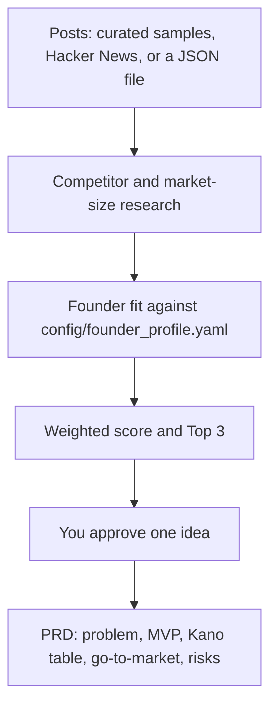

# Lifestyle Startup Discovery

This project turns public pain-point posts into ranked lifestyle-business ideas, then writes a product requirements document for the idea you approve.

A lifestyle business here means a small software product: under the budget in [`config/founder_profile.yaml`](config/founder_profile.yaml) (default `$2,500`), a short MVP, and a small team. The sample data includes an "start an airline" post so you can see that idea get rejected.

You do not need a Reddit API key. Live posts come from the free [Hacker News Algolia API](https://hn.algolia.com/api). Gemini does the writing when `GEMINI_API_KEY` is set. Without that key, the same commands still finish using a built-in fallback.

---

## Run it

From the repo folder in PowerShell:

```powershell
python -m venv .venv
.\.venv\Scripts\Activate.ps1
pip install -r requirements.txt
Copy-Item .env.example .env
```

Open `.env` and set `GEMINI_API_KEY` to a key from [Google AI Studio](https://aistudio.google.com/apikey). Leave `API_AUTH_KEY` empty for local runs. Do not commit `.env`.

Optional: edit [`config/founder_profile.yaml`](config/founder_profile.yaml) so scores use your budget, skills, and weekly hours.

### 1. Sample posts (start here)

```powershell
python cli.py --source curated
```

This runs both stages on five built-in posts. It is quiet while Gemini works, then prints a Top 3. It writes:

| File | What it is |
| :--- | :--- |
| `outputs/stage1_evaluated_ideas.json` | Every idea, score, market size, and cost |
| `outputs/google_sheets_evaluated_ideas.csv` | The same rows, in sheet-column form |
| `outputs/google_doc_prd_top1.md` | The PRD for the winning idea |

Success looks like `agent_mode=gemini` in the console. `fallback` means a step threw an error and the handwritten backup was used. The warning above that line is the reason.

### 2. Live Hacker News posts

```powershell
python cli.py --source hn
```

Same output files, overwritten. Expect several minutes with no new lines. The command is not looping: it fetches about 15–20 stories, then calls Gemini three times per idea (research, founder fit, score) before Stage 2. Stop it with Ctrl+C if it sits for more than about 15 minutes with no output. DuckDuckGo competitor search has no timeout and can hang.

Other inputs: `--source reddit_rss` (best effort, often blocked), `--source all`, or `--posts-file posts.json` for your own JSON list.

### 3. API

Use a terminal that is not already running the CLI:

```powershell
python -m src.main
```

Leave that window open. Uvicorn listens on http://localhost:8000.

Open **http://localhost:8000/docs**. The site root (`/`) returns 404. A `GET /json/version` 404 is a browser probe, not a crashed server.

- http://localhost:8000/health returns `"status": "ok"` and the loaded skills.
- `POST /api/v1/stage1/evaluate` ranks posts. For a short first call, send `{"posts": [], "source": "curated", "fetch_live": false}`.
- `POST /api/v1/stage2/generate-prd` writes a PRD. Required fields are `idea_title` and `core_problem`. Read `google_doc_markdown` in the response.

`source: "hn"` with `"fetch_live": true` is the long Hacker News run. Swagger will look idle until it returns.

### 4. Tests

```powershell
pytest
```

The default run does not call Gemini or Hacker News. One live model test stays skipped unless `RUN_LIVE_GEMINI=1`.

---

## n8n (optional)

n8n does not replace the API. It calls the API. You do not need a Reddit key or an n8n cloud account.

1. Keep `python -m src.main` running.
2. In another terminal, start n8n (`npx n8n`).
3. Set n8n's `PIPELINE_BASE_URL` to `http://localhost:8000`.
4. Import:
   - [`n8n/stage1_reddit_to_sheets_evaluator.json`](n8n/stage1_reddit_to_sheets_evaluator.json)
   - [`n8n/stage2_sheets_human_approval_to_gdoc_prd.json`](n8n/stage2_sheets_human_approval_to_gdoc_prd.json)
5. Connect Google Sheets and Google Docs. Replace `YOUR_GOOGLE_SHEET_ID_HERE`. Create a tab named `Evaluated_Ideas` whose headers match `outputs/google_sheets_evaluated_ideas.csv`.
6. Run Stage 1 once. Set one Top 3 row's `Approval_Status` to `Approved`. Stage 2 creates a Google Doc and writes the URL back.

The Stage 1 HTTP node times out after 120 seconds. A full Hacker News plus Gemini run is often slower, so raise that timeout or send curated posts for the first sheet test.

If `API_AUTH_KEY` is set on the server, set the same value in n8n. Local runs should leave it blank.

---

## What the two stages do



Stage 1 extracts one idea per post, estimates competitors and a bottom-up market size (reachable buyers times annual price), scores founder fit, and keeps the best three ideas whose startup cost is inside your budget.

Stage 2 writes the PRD for the approved idea: problem, value proposition, 30-day MVP, feature priority, go-to-market, risks, and 48-hour tests.

Each step is a LangGraph node. The instructions live in `.agents/skills/*/SKILL.md` and are loaded by [`src/skill_loader.py`](src/skill_loader.py). The 100-point total is recomputed in code from the five subscores.

| Skill | File | Job |
| :--- | :--- | :--- |
| Supervisor | [`.agents/skills/supervisor-orchestrator/SKILL.md`](.agents/skills/supervisor-orchestrator/SKILL.md) | Orders Stage 1 and Stage 2 |
| Market research | [`.agents/skills/competitive-market-researcher/SKILL.md`](.agents/skills/competitive-market-researcher/SKILL.md) | Competitors, bottom-up market size, startup cost |
| Founder fit | [`.agents/skills/founder-market-fit/SKILL.md`](.agents/skills/founder-market-fit/SKILL.md) | Compares the idea with your YAML profile |
| Evaluator | [`.agents/skills/startup-evaluator/SKILL.md`](.agents/skills/startup-evaluator/SKILL.md) | Scores ideas and picks the Top 3 |
| PM | [`.agents/skills/pm-strategist/SKILL.md`](.agents/skills/pm-strategist/SKILL.md) | Problem, MVP, Kano table, go-to-market |
| Risk | [`.agents/skills/risk-analyst/SKILL.md`](.agents/skills/risk-analyst/SKILL.md) | Risks and 48-hour validation tests |

`agent_mode` on every API response is `gemini` only when every agent step accepted a model result. `node_errors` lists the exceptions that caused a fallback. There is no trace viewer in this repo.

---

## Free hosting

No Reddit key.

1. **Gemini:** the same AI Studio key, as `GEMINI_API_KEY` on the host.
2. **Posts:** Hacker News Algolia. No key.
3. **API:** build the `Dockerfile` and deploy to [Cloud Run](https://cloud.google.com/run) (scale to zero) or a [Render](https://render.com) free web service (sleeps when idle). Set `GEMINI_API_KEY`, `API_AUTH_KEY`, and `PORT`. Use `/health` as the health check. It does not require the API key.
4. **Approval:** a Google Sheet. A person sets `Approval_Status` to `Approved`.

A daily GitHub Actions call, using repository secrets rather than a workflow committed to run on push:

```yaml
name: Evaluate HN pain points
on:
  schedule:
    - cron: "0 12 * * *"
  workflow_dispatch:
jobs:
  evaluate:
    runs-on: ubuntu-latest
    steps:
      - name: Call Stage 1
        run: |
          curl -fsS -X POST "$PIPELINE_BASE_URL/api/v1/stage1/evaluate" \
            -H "Content-Type: application/json" \
            -H "X-API-Key: $API_AUTH_KEY" \
            -d '{"posts":[],"source":"hn","fetch_live":true}'
        env:
          PIPELINE_BASE_URL: ${{ secrets.PIPELINE_BASE_URL }}
          API_AUTH_KEY: ${{ secrets.API_AUTH_KEY }}
```

Stage 2 can be an Apps Script installable trigger on that sheet (`Extensions` → `Apps Script`). A simple `onEdit` trigger cannot call `UrlFetchApp`.

```javascript
function onEdit(e) {
  var sheet = e.range.getSheet();
  if (sheet.getName() !== "Evaluated_Ideas") return;
  var row = e.range.getRow();
  var headers = sheet.getRange(1, 1, 1, sheet.getLastColumn()).getValues()[0];
  function col(name) { return headers.indexOf(name) + 1; }
  if (e.range.getColumn() !== col("Approval_Status")) return;
  if (e.value !== "Approved") return;
  if (sheet.getRange(row, col("Google_Doc_PRD_URL")).getValue()) return;

  var payload = {
    idea_id: sheet.getRange(row, col("Idea_ID")).getValue(),
    idea_title: sheet.getRange(row, col("Idea_Title")).getValue(),
    one_line_pitch: sheet.getRange(row, col("One_Line_Pitch")).getValue(),
    core_problem: sheet.getRange(row, col("Core_Problem")).getValue(),
    target_customer: sheet.getRange(row, col("Target_Customer")).getValue(),
    source_subreddit: sheet.getRange(row, col("Source_Subreddit")).getValue(),
    source_reddit_title: sheet.getRange(row, col("Source_Reddit_Title")).getValue(),
    source_reddit_url: sheet.getRange(row, col("Source_Reddit_URL")).getValue(),
    bottom_up_tam_summary: sheet.getRange(row, col("TAM_Formula")).getValue(),
    startup_cost_summary: sheet.getRange(row, col("Startup_Cost_Breakdown")).getValue(),
    competitors_summary: sheet.getRange(row, col("Competitors")).getValue(),
    competitive_wedge: sheet.getRange(row, col("Competitive_Wedge")).getValue(),
    founder_fit_summary: sheet.getRange(row, col("Founder_Fit_Rationale")).getValue()
  };
  var response = UrlFetchApp.fetch(PropertiesService.getScriptProperties().getProperty("PIPELINE_BASE_URL") + "/api/v1/stage2/generate-prd", {
    method: "post",
    contentType: "application/json",
    headers: { "X-API-Key": PropertiesService.getScriptProperties().getProperty("API_AUTH_KEY") },
    payload: JSON.stringify(payload),
    muteHttpExceptions: true
  });
  var body = JSON.parse(response.getContentText());
  var doc = DocumentApp.create(body.document_title);
  doc.getBody().setText(body.google_doc_markdown);
  sheet.getRange(row, col("Google_Doc_PRD_URL")).setValue(doc.getUrl());
  sheet.getRange(row, col("Approval_Status")).setValue("PRD Generated");
}
```

Store `PIPELINE_BASE_URL` and `API_AUTH_KEY` in the script properties.
