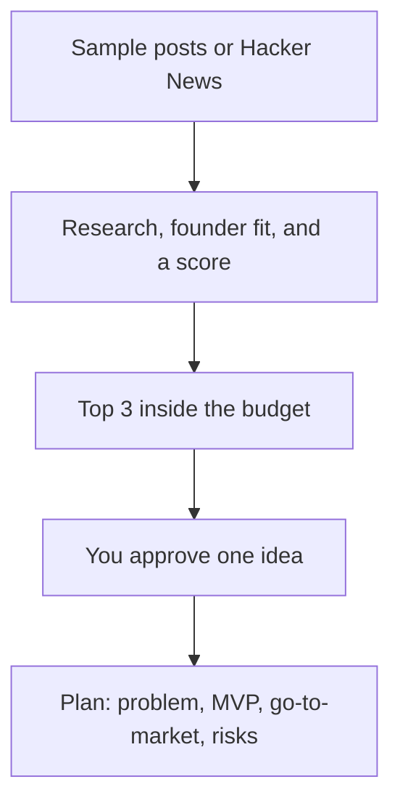

# Lifestyle Startup Discovery

This pipeline reads posts where people describe a painful workflow, turns each post into a small software idea, scores it for the founder in [`config/founder_profile.yaml`](config/founder_profile.yaml), and writes a product plan for the winner.

A lifestyle business here means a narrow product under that profile’s budget (default $2,500) that a small team can ship. Live posts come from the [Hacker News Algolia API](https://hn.algolia.com/api). The five sample posts live in the repo. Their Reddit links are placeholders.

The score is recomputed in code from five parts: pain 25%, startup cost 25%, competition 20%, market size 15%, founder fit 15%.

| Layer | Choice |
| :--- | :--- |
| API | Python, FastAPI |
| Agents | LangGraph, one step per specialist |
| Model | Gemini (`gemini-2.5-flash`) |
| Instructions | [Agent Skills](https://agentskills.io/home) files in `.agents/skills/` |
| Approval | n8n, Google Sheets, Google Docs |

## See a result

From the repository root in PowerShell:

```powershell
python -m venv .venv
.\.venv\Scripts\Activate.ps1
pip install -r requirements.txt
Copy-Item .env.example .env
```

Put your `GEMINI_API_KEY` in `.env`. Leave `API_AUTH_KEY` empty. Do not commit `.env`.

```powershell
python cli.py --source curated
```

The terminal stays quiet while Gemini works. When it prints `agent_mode=gemini`, open:

| File | What you see |
| :--- | :--- |
| `outputs/google_doc_prd_top1.md` | Product plan for the top idea |
| `outputs/stage1_evaluated_ideas.json` | Every idea, score, market size, and cost |
| `outputs/google_sheets_evaluated_ideas.csv` | The same rows as a table |

`agent_mode=fallback` means a model call failed and the built-in writeup was used. The line above it names the failure. While the run is going, the terminal prints a line for each step, such as `Researching 2 of 3`.

To view the scores in the browser, start `python -m src.main` and open [http://localhost:8000/](http://localhost:8000/). That page lists the top 3, the five score parts, earlier runs, and a button that writes a plan for one idea. [http://localhost:8000/founder](http://localhost:8000/founder) edits the budget, weekly hours, and skills used by the next run.

One sample run is about 19 Gemini calls. The free daily limit is about 20. Run it once. If you see `429`, stop with Ctrl+C and wait until the daily window resets. Files already in `outputs/` are still the last result.

## Live posts

```powershell
python cli.py --source hn
```

This downloads at most 3 Hacker News stories, scores them, and rewrites the same three files. Links should start with `https://news.ycombinator.com/item?id=`. If the terminal says `source=curated`, the download failed and you are looking at the sample posts again.

## Google Sheets approval

Use this when you want the rows in a sheet and a Google Doc only after you approve one idea. The command above does not do that. It writes files on your computer and treats idea #1 as approved.

1. Start the API and leave it running: `python -m src.main`
2. In a second terminal, run `npx n8n` and open the local address it prints. The owner email it asks for stays on your computer.
3. Import [`n8n/stage1_reddit_to_sheets_evaluator.json`](n8n/stage1_reddit_to_sheets_evaluator.json) and [`n8n/stage2_sheets_human_approval_to_gdoc_prd.json`](n8n/stage2_sheets_human_approval_to_gdoc_prd.json).
4. On the Google nodes, sign in with Google. The workflows already call `http://localhost:8000`. Point them at your sheet if the id in the file is not yours. The tab must be named `Evaluated_Ideas`, with the header row from `outputs/google_sheets_evaluated_ideas.csv`.
5. Open the Stage 1 workflow and click **Execute workflow**. Wait until the Sheets node is green. The sheet should gain rows from Hacker News.
6. Turn the Stage 2 workflow on. Set one Top 3 row’s `Approval_Status` to `Approved`. A link appears in `Google_Doc_PRD_URL`.

Those results stay in Google Sheets and Google Docs.

## What a run does



Each box is a LangGraph step. The instructions are the `SKILL.md` files in `.agents/skills/`: market research, founder fit, scoring, product plan, and risk.

## Tests and hosting

```powershell
pytest
```

That run does not call Gemini or Hacker News. It checks that the sample ideas stay in order (CertPing, ScopeGuard, PauseSave, then Nightbook), the airline idea stays out of the top 3, each total matches the five-part formula, and a made-up article URL is replaced by the fetched one.

To host the API, build the included `Dockerfile` and run it on [Cloud Run](https://cloud.google.com/run) with a request timeout of at least 15 minutes. Set `GEMINI_API_KEY` and `PORT`. Use `/health` as the health check.
