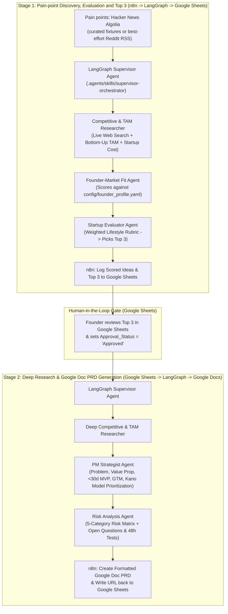

# Lifestyle Startup Discovery & Google Doc PRD Multi-Agent Pipeline

A **Hybrid n8n + LangGraph Multi-Agent System** built on the open **[Agent Skills (`agentskills.io`)](https://agentskills.io/home)** specification and inspired by **[n8n Workflow #6094](https://n8n.io/workflows/6094-generate-startup-ideas-from-reddit-posts-using-gemini-ai-and-google-sheets/)**.

---

## Architecture Overview

This project implements a **Two-Stage Human-in-the-Loop Pipeline** focused strictly on **Bootstrapped Lifestyle Businesses** (low startup cost `<$2,500`, `<30-day` MVP build, high gross margins, solo/small-team friendly):



---

## Standardized `agentskills.io` Modules (`.agents/skills/`)

Every specialized agent is packaged as a portable `SKILL.md` module under `.agents/skills/` so it can be loaded dynamically by the **Python LangGraph backend** ([`src/skill_loader.py`](src/skill_loader.py)) **and** discovered natively by any `agentskills.io`-compatible coding agent (Antigravity, Gemini CLI, Claude Code, Cursor):

| Agent Skill | Path | Responsibility |
| :--- | :--- | :--- |
| **Supervisor Orchestrator** | [`.agents/skills/supervisor-orchestrator/SKILL.md`](.agents/skills/supervisor-orchestrator/SKILL.md) | Orchestrates Stage 1 (Reddit → Top 3 in Google Sheets) and Stage 2 (Approved Sheet Row → Google Doc PRD). |
| **Competitive & Market Researcher** | [`.agents/skills/competitive-market-researcher/SKILL.md`](.agents/skills/competitive-market-researcher/SKILL.md) | Runs live web search for competitors, calculates **Bottom-Up TAM** ($\text{Target Users} \times \text{Annual Price}$), and estimates initial **Startup Cost**. |
| **Founder-Market Fit Agent** | [`.agents/skills/founder-market-fit/SKILL.md`](.agents/skills/founder-market-fit/SKILL.md) | Evaluates ideas against [`config/founder_profile.yaml`](config/founder_profile.yaml) (skills, budget ceiling, weekly hours, unfair advantages). |
| **Startup Evaluator Agent** | [`.agents/skills/startup-evaluator/SKILL.md`](.agents/skills/startup-evaluator/SKILL.md) | Scores ideas on the 5-part **Lifestyle Business Rubric** and selects the **Top 3**. |
| **PM Strategist Agent** | [`.agents/skills/pm-strategist/SKILL.md`](.agents/skills/pm-strategist/SKILL.md) | Writes Problem Statement, Value Proposition, `<30-Day` MVP Scope, GTM Strategy, and **Kano Model Feature Prioritization** mapped to Reddit pain points. |
| **Risk Analysis Agent** | [`.agents/skills/risk-analyst/SKILL.md`](.agents/skills/risk-analyst/SKILL.md) | Generates the 5-category Risk Matrix and **Open Questions** with `<48-hour` validation experiments. |

---

## Quickstart

### 1. Install Dependencies
```powershell
pip install -r requirements.txt
```

### 2. Configure Environment & Founder Profile
1. Copy `.env.example` to `.env` and set your `GEMINI_API_KEY`:
   ```powershell
   Copy-Item .env.example .env
   ```
2. Customize [`config/founder_profile.yaml`](config/founder_profile.yaml) with your specific founder or team profile (e.g., Jev, Rita, VJ), technical skills, max startup cost budget, and weekly hours.

### 3. Run the End-to-End Pipeline via CLI
The default run stays offline and uses the curated fixture posts. It writes a Google Sheets CSV preview (`outputs/google_sheets_evaluated_ideas.csv`) and a PRD (`outputs/google_doc_prd_top1.md`):
```powershell
python cli.py --source curated
```

Live pain points come from the Hacker News Algolia API, which needs no key. With `GEMINI_API_KEY` set, the same command uses Gemini; without it, the deterministic fallback still runs:
```powershell
python cli.py --source hn
```

Other sources: `--source reddit_rss` (best-effort public feeds, no Reddit OAuth) and `--source all`. `--posts-file posts.json` evaluates a JSON list of posts and does not fetch.

### 4. Start the FastAPI Server for n8n
```powershell
python -m src.main
```
- Interactive Swagger UI: `http://localhost:8000/docs`
- Stage 1 Webhook: `POST http://localhost:8000/api/v1/stage1/evaluate`
- Stage 2 Webhook: `POST http://localhost:8000/api/v1/stage2/generate-prd`

Empty `posts` with `"source": "hn"` and `"fetch_live": true` makes Stage 1 fetch Hacker News itself. Set `API_AUTH_KEY` to require an `X-API-Key` header on `/api/*`. `/health` stays open.

### 5. Import the n8n Workflows (local option)
n8n is optional. The Stage 1 workflow no longer uses a Reddit credential.
1. Set n8n environment variables `PIPELINE_BASE_URL` (for example `http://localhost:8000`) and, if you set `API_AUTH_KEY`, the same value as `API_AUTH_KEY`.
2. Import:
   - [`n8n/stage1_reddit_to_sheets_evaluator.json`](n8n/stage1_reddit_to_sheets_evaluator.json) — daily trigger posts `{"posts": [], "source": "hn", "fetch_live": true}`
   - [`n8n/stage2_sheets_human_approval_to_gdoc_prd.json`](n8n/stage2_sheets_human_approval_to_gdoc_prd.json)
3. Connect **Google Sheets** and **Google Docs** credentials and replace `YOUR_GOOGLE_SHEET_ID_HERE` with your spreadsheet ID. Create a tab named `Evaluated_Ideas`.

### 6. Tests
```powershell
pip install -r requirements.txt
pytest
```
The default pytest run does not call Gemini, Hacker News, or Reddit. A live model check exists and stays skipped unless `GEMINI_API_KEY` is set and `RUN_LIVE_GEMINI=1`.

---

## Free hosting

A $0 deploy uses four free pieces. No Reddit API key is required.

1. **Gemini:** create a key in [Google AI Studio](https://aistudio.google.com/apikey) and set `GEMINI_API_KEY`. The default model is `gemini-2.5-flash`.
2. **Pain points:** Hacker News via `https://hn.algolia.com/api/v1/search`. No key.
3. **API:** build the included `Dockerfile` and deploy it to [Google Cloud Run](https://cloud.google.com/run) on the free tier (scale to zero). [Render](https://render.com) free web services are the alternative; they sleep after inactivity, so the first request is slow. Set `GEMINI_API_KEY`, `API_AUTH_KEY`, and `PORT` in the host environment. Do not commit `.env`.
4. **Human gate:** a Google Sheet. Stage 1 appends scored rows. A person sets `Approval_Status` to `Approved`.

**Schedule Stage 1 with GitHub Actions** (store the URL and key as repository secrets; this example is not committed as a workflow that runs on push):

```yaml
name: Evaluate HN pain points
on:
  schedule:
    - cron: "0 12 * * *"
  workflow_dispatch:
jobs:
  evaluate:
    runs-on: ubuntu-latest
    steps:
      - name: Call Stage 1
        run: |
          curl -fsS -X POST "$PIPELINE_BASE_URL/api/v1/stage1/evaluate" \
            -H "Content-Type: application/json" \
            -H "X-API-Key: $API_AUTH_KEY" \
            -d '{"posts":[],"source":"hn","fetch_live":true}'
        env:
          PIPELINE_BASE_URL: ${{ secrets.PIPELINE_BASE_URL }}
          API_AUTH_KEY: ${{ secrets.API_AUTH_KEY }}
```

Write the JSON response into the sheet with a Google service account, or keep the n8n Sheets node if you run n8n locally.

**Stage 2 with Apps Script** bound to that spreadsheet (`Extensions` → `Apps Script`). The script calls the public API when a row is marked Approved and the doc URL cell is still empty:

```javascript
function onEdit(e) {
  var sheet = e.range.getSheet();
  if (sheet.getName() !== "Evaluated_Ideas") return;
  var row = e.range.getRow();
  var headers = sheet.getRange(1, 1, 1, sheet.getLastColumn()).getValues()[0];
  function col(name) { return headers.indexOf(name) + 1; }
  if (e.range.getColumn() !== col("Approval_Status")) return;
  if (e.value !== "Approved") return;
  if (sheet.getRange(row, col("Google_Doc_PRD_URL")).getValue()) return;

  var payload = {
    idea_id: sheet.getRange(row, col("Idea_ID")).getValue(),
    idea_title: sheet.getRange(row, col("Idea_Title")).getValue(),
    one_line_pitch: sheet.getRange(row, col("One_Line_Pitch")).getValue(),
    core_problem: sheet.getRange(row, col("Core_Problem")).getValue(),
    target_customer: sheet.getRange(row, col("Target_Customer")).getValue(),
    source_subreddit: sheet.getRange(row, col("Source_Subreddit")).getValue(),
    source_reddit_title: sheet.getRange(row, col("Source_Reddit_Title")).getValue(),
    source_reddit_url: sheet.getRange(row, col("Source_Reddit_URL")).getValue(),
    bottom_up_tam_summary: sheet.getRange(row, col("TAM_Formula")).getValue(),
    startup_cost_summary: sheet.getRange(row, col("Startup_Cost_Breakdown")).getValue(),
    competitors_summary: sheet.getRange(row, col("Competitors")).getValue(),
    competitive_wedge: sheet.getRange(row, col("Competitive_Wedge")).getValue(),
    founder_fit_summary: sheet.getRange(row, col("Founder_Fit_Rationale")).getValue()
  };
  var response = UrlFetchApp.fetch(PropertiesService.getScriptProperties().getProperty("PIPELINE_BASE_URL") + "/api/v1/stage2/generate-prd", {
    method: "post",
    contentType: "application/json",
    headers: { "X-API-Key": PropertiesService.getScriptProperties().getProperty("API_AUTH_KEY") },
    payload: JSON.stringify(payload),
    muteHttpExceptions: true
  });
  var body = JSON.parse(response.getContentText());
  var doc = DocumentApp.create(body.document_title);
  doc.getBody().setText(body.google_doc_markdown);
  sheet.getRange(row, col("Google_Doc_PRD_URL")).setValue(doc.getUrl());
  sheet.getRange(row, col("Approval_Status")).setValue("PRD Generated");
}
```

Put `PIPELINE_BASE_URL` and `API_AUTH_KEY` in Apps Script's Script Properties. A simple `onEdit` trigger cannot call `UrlFetchApp`; install the function as an installable trigger instead. Cloud Run's `/health` endpoint can be used as the service health check because it does not require the API key.
